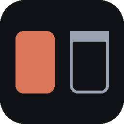

<p align="center">
  
</p>

<h1 align="center">aimux</h1>

<p align="center">
  Desktop chat sučelje za <b>Claude Code</b>: više razgovora usporedno, svaki sa svojim vidljivim browserom.<br>
  Zamjena za wmux, bez terminala i konzolnog izgleda.
</p>

<p align="center">
  <a href="https://github.com/HRyohni/MyMux/releases/latest">Preuzmi</a> ·
  <a href="#značajke">Značajke</a> ·
  <a href="#prečaci">Prečaci</a> ·
  <a href="#razvoj">Razvoj</a>
</p>

---

aimux pokreće Claude Code preko [Claude Agent SDK-a](https://www.npmjs.com/package/@anthropic-ai/claude-agent-sdk) i prikazuje poruke,
pozive alata, diffove i odobrenja kao normalan chat. Pored razgovora je browser panel u kojem gledaš što Claude radi na webu
(i možeš sam klikati), a otvara i PDF, Word, Excel, PowerPoint i Markdown datoteke.

Koristi istu prijavu, modele, postavke, `CLAUDE.md`, skillove i hookove kao tvoj Claude Code CLI
(`settingSources: user, project, local`), pa ništa ne treba posebno podešavati.

## Instalacija

1. Preuzmi `aimux Setup x.y.z.exe` s [Releases](https://github.com/HRyohni/MyMux/releases/latest) i pokreni ga.
2. Budi prijavljen u Claude Code (`claude` → `/login`) ili postavi `ANTHROPIC_API_KEY`.
3. Pokreni aimux, odaberi radnu mapu i piši.

Aplikacija se sama ažurira: nova verzija se preuzme u pozadini i instalira pri zatvaranju.

> Instaler nije potpisan, pa Windows SmartScreen pri prvom pokretanju traži potvrdu (*Više informacija → Ipak pokreni*).

## Značajke

### Paneli i grupe
- **Split panela**: više razgovora usporedno (desno ili dolje), svaki sa svojim browserom. Razgovor iz bočne trake povučeš u bilo koji panel.
- **Grupe**: svaka grupa je zaseban raspored panela (npr. tri razgovora za jedan projekt, tri za drugi). Dvoklik preimenuje, X zatvara.
- **Raspored se pamti**: grupe, splitovi, omjeri i otvoreni razgovori vraćaju se nakon ponovnog pokretanja. Imenovani rasporedi su u *Postavke → Rasporedi*.
- **Pregled svih razgovora** (Ctrl+Shift+O): stanje, kontekst, trošak i broj izmjena po razgovoru.

### Razgovor
- **Odobrenja s diffom**: Edit/Write se prije odobrenja vide kao diff. Uz *Odbij* možeš napisati što da Claude napravi umjesto toga.
- **Pitanja i plan**: `AskUserQuestion` je kartica s ponuđenim odgovorima; plan iz Plan načina je čitljiv dokument s gumbima za odobravanje ili nastavak planiranja.
- **Slash komande i `@` datoteke**: `/` nudi ugrađene komande, skillove i komande projekta; `@` pretražuje radnu mapu (poštuje `.gitignore`).
- **Prilozi**: spajalica, povlačenje ili Ctrl+V. Slike idu kao slike, ostalo kao putanja.
- **Red čekanja**: poruka poslana dok Claude radi čeka kraj odgovora, ili je pošalješ odmah (munja) da je Claude vidi između dva koraka.
- **Rad s porukama**: kopiraj, uredi, ponovi, grananje u novi panel i *vrati datoteke* na stanje prije te poruke (SDK file checkpointing).
- **Zadaci i podagenti**: lista zadataka je prikvačena iznad polja dok ima nedovršenih; Agent kartica sadrži cijeli razgovor podagenta.
- **Kontekst i trošak**: popunjenost kontekstnog prozora, trošak sesije i trošak svakog odgovora.
- **Model, effort i način odobravanja** biraju se ispod polja za poruku, po razgovoru.
- **Izbornik „⋯”**: screenshot browsera kao prilog, `/add-dir`, prošireno razmišljanje, brzi način i tvoji predlošci poruka.
- **Pozadinski zadaci, hookovi i MCP unos**: pozadinski agenti imaju gumb za zaustavljanje, greške hookova se ispisuju u razgovoru, MCP obrasci i URL koraci dolaze kao kartice.

### Browser panel
- Svaka sesija ima svoje tabove. Claude ih koristi preko ugrađenih `browser_*` alata (bez traženja odobrenja), a ti ih vidiš uživo i možeš sam klikati ili upisati URL.
- Otvara **PDF, DOCX, XLSX/CSV, PPTX, Markdown** i tekst. Ikona uz putanju u Read/Edit/Write kartici otvara tu datoteku u panelu.
- Stablo datoteka radne mape, zoom, pretraga na stranici, DevTools i popis preuzimanja.

### Git, sesije i izvoz
- **Git** (ikona grane): izmjene u radnom stablu s diffom prema HEAD-u, commit, stash i *Novi worktree + razgovor* da dva razgovora ne diraju iste datoteke.
- **Sesije**: nastavak bilo koje prijašnje Claude Code sesije s poviješću, pretraga po naslovu i sadržaju transkripta, preimenovanje, arhiviranje, brisanje i fork.
- **Izvoz** razgovora u Markdown ili HTML.
- **Suradnja razgovora**: Claude vidi druge otvorene razgovore (`session_list`) i može im poslati poruku (`session_send`, uz tvoje odobrenje).
- **Remote Control** (ikona mobitela): isti razgovor nastaviš s claude.ai ili mobilne aplikacije. Traži claude.ai račun, ne radi s API ključem.

### Obavijesti
Obavijest stiže kad Claude završi, čeka odobrenje, ima pitanje ili plan; klik otvara taj razgovor. Ikona u traci pokazuje koliko razgovora čeka tebe,
a koliko radi. Kraj odgovora prati kratak zvuk (dublji kod greške), koji se gasi gumbom sa zvučnikom.

## Postavke

`Ctrl+,` otvara postavke: tema, veličina prikaza, zvuk, zadani model, effort i način odobravanja, prečaci, predlošci poruka i rasporedi.
Kartice za razgovor u fokusiranom panelu:

- **MCP serveri**: status, greške, ponovno spajanje i uključivanje. Serveri dodani u aplikaciji vrijede za svaki novi razgovor u aimuxu i ne diraju konfiguraciju Claude Codea.
- **Dopuštenja i hookovi**: pravila se dodaju i uklanjaju (zadano u `.claude/settings.local.json` projekta); hookovi se samo pregledavaju.
- **Račun i potrošnja**: pretplata i iskorištenost limita (5 sati, 7 dana).

## Prečaci

| Tipke | Akcija |
|---|---|
| `Ctrl+N` | novi razgovor u fokusiranom panelu |
| `Ctrl+\` / `Ctrl+Shift+\` | podijeli panel desno / dolje |
| `Ctrl+W` | zatvori panel (razgovor ostaje u bočnoj traci) |
| `Ctrl+T` | nova grupa |
| `Ctrl+1` … `Ctrl+9` | prebaci na grupu |
| `Ctrl+Tab` / `Ctrl+Shift+Tab` | sljedeća / prethodna grupa |
| `Ctrl+Shift+W` | zatvori grupu |
| `Ctrl+B` | prikaži / sakrij browser panel |
| `Ctrl+Shift+B` | prikaži / sakrij bočnu traku |
| `Ctrl+F` | pretraži razgovor (u browseru: stranicu) |
| `Ctrl+Shift+O` | pregled svih razgovora |
| `Ctrl+,` | postavke |
| `Enter` / `Shift+Enter` | pošalji / novi red |

Svi prečaci se mogu promijeniti u postavkama. Dok je fokus u browser panelu vrijede `Ctrl+T`/`Ctrl+W` (tab), `Ctrl+F`, `Ctrl +/-/0` (zoom) i `F12` (DevTools).

## Razvoj

Treba Node.js 20+.

```bash
npm install
npm run dev          # dev mode s hot reloadom
npm start            # build + pokretanje
npm run typecheck
npm test             # vitest
npm run dist         # Windows instaler -> dist/
npm run dist:mac     # macOS dmg (na macOS-u)
npm run dist:linux   # Linux AppImage (na Linuxu)
npm run release      # Windows build + objava na GitHub Releases (treba GH_TOKEN)
```

Stack: Electron, electron-vite, React, Tailwind, zustand, Claude Agent SDK, Playwright (preko CDP-a).

### Struktura

| Putanja | Sadržaj |
|---|---|
| `src/main/agent.ts` | sesije preko `query()` sa streaming ulazom, odobrenja (`canUseTool`) |
| `src/main/browser.ts` | `WebContentsView` po tabu + Playwright preko CDP-a |
| `src/main/browserTools.ts` | in-process MCP server `aimux` s `browser_*` alatima |
| `src/main/documents.ts` | DOCX (mammoth), XLSX/CSV (SheetJS), PPTX (JSZip), Markdown → HTML za browser panel |
| `src/main/files.ts` | pretraga za `@` spominjanja, privremeni prilozi |
| `src/main/git.ts` | status, diff, commit, stash, worktree |
| `src/main/extras.ts` | stablo datoteka, pretraga transkripata, podagenti, izvoz, pravila dopuštenja |
| `src/main/updater.ts` | auto-update (electron-updater) |
| `src/main/index.ts` | prozor, IPC, obavijesti, dev hookovi |
| `src/preload/` | `window.aimux` API (contextBridge) |
| `src/renderer/` | React UI; čista logika s testovima: `reducer.ts`, `layout.ts`, `diff.ts`, `keys.ts` |
| `src/shared/ipc.ts` | tipovi IPC ugovora |

<details>
<summary><b>Dev hookovi (env varijable)</b></summary>

| Varijabla | Što radi |
|---|---|
| `AIMUX_AUTOPROMPT` | pošalje prompt odmah nakon pokretanja |
| `AIMUX_CWD` | radna mapa za autoprompt sesiju |
| `AIMUX_AUTOOPEN=put.pdf` | otvori datoteku u browser panelu nakon pokretanja |
| `AIMUX_AUTORESUME=latest\|<id>` | nastavi zadnju (ili zadanu) sesiju iz `AIMUX_CWD` |
| `AIMUX_AUTOSPLIT=horizontal\|vertical` | podijeli panel nakon pokretanja |
| `AIMUX_AUTOANSWER=allow\|deny` | automatski odgovara na odobrenja (`AIMUX_AUTOANSWER_DELAY` ms) |
| `AIMUX_AUTOIMAGE=put.png` | priloži sliku uz `AIMUX_AUTOPROMPT` |
| `AIMUX_MODE=plan` | način odobravanja za autoprompt sesiju (`plan`, `acceptEdits`, …) |
| `AIMUX_SCREENSHOT=put.png` | snimi prozor nakon `AIMUX_SCREENSHOT_DELAY` ms (više vrijednosti odvojenih zarezom) |
| `AIMUX_TOGGLE_SIDEBAR=ms` | sklopi/rasklopi bočnu traku nakon zadanog vremena |
| `AIMUX_CDP_PORT=9333` | fiksni CDP port za testne skripte (Playwright `connectOverCDP`) |
| `AIMUX_USER_DATA=mapa` | zaseban profil, da test ne dira pokrenutu aplikaciju |
| `AIMUX_NO_UPDATE=1` | preskoči provjeru nove verzije |
| `AIMUX_DEBUG=1` | ispisuje tipove SDK poruka u konzolu |

Aplikacija je single-instance: drugo pokretanje s istim profilom samo fokusira postojeći prozor.
</details>

<details>
<summary><b>Kako radi browser panel</b></summary>

- Electron se pokreće s `--remote-debugging-port` na slobodnom localhost portu. Playwright se spaja preko `connectOverCDP`
  i pronalazi stranicu po jedinstvenom početnom `data:` URL-u (naslov `aimux-<sessionId>`).
- Alati `mcp__aimux__browser_*` (navigate, open_file, snapshot, get_text, click, type, select, press, scroll, screenshot, eval, back, tabs, wait)
  su u `allowedTools`, pa ne traže odobrenje. Snapshot označava interaktivne elemente atributom `data-aimux-ref` (e1, e2…).
- Renderer samo mjeri placeholder `<div>` i šalje `setBounds`. Nativni view je uvijek iznad DOM-a, pa se browser sakrije dok je otvoren dijalog.
- PDF radi preko Chromium PDF viewera (`webPreferences.plugins: true`). Poveznice koje otvaraju novi prozor otvaraju novi tab.
</details>

<details>
<summary><b>Napomene o Agent SDK-u</b></summary>

- Uz `includePartialMessages` SDK šalje `assistant` poruku **po svakom bloku**, ne po cijeloj poruci.
  UI gradi blokove iz `stream_event` događaja, a iz `assistant` poruka uzima samo konačni `input` alata.
- SDK ne vraća korisnikov prompt natrag; main proces ga sam emitira u UI.
- Rezultati alata stižu kao `user` poruke s `tool_result` blokovima.
</details>

## Distribucija

- **Auto-update** provjerava GitHub Releases repozitorija iz `build.publish` (`HRyohni/MyMux`). Za privatni repozitorij korisnik treba token, pa je praktičan samo javni.
- **Potpisivanje**: electron-builder potpisuje instaler ako su postavljeni `CSC_LINK` (.pfx ili base64) i `CSC_KEY_PASSWORD`.
- **Platforme**: Windows (nsis, x64) je isproban; macOS (dmg, arm64/x64) i Linux (AppImage, x64) su konfigurirani, ali nisu isprobani.

## Poznata ograničenja

- Vraćanje rasporeda pokreće po jedan Claude Code proces za svaki razgovor koji je bio otvoren.
- Uređivanje/ponavljanje poruke vraća razgovor, ali ne i datoteke; za to postoji *Vrati datoteke*.
- MCP serveri s OAuth prijavom autoriziraju se u CLI-ju (`/mcp`); aplikacija prikazuje status i nudi ponovno spajanje.
- Nema ugrađenog glasovnog unosa (Web Speech API u Electronu ne radi bez Googleovog ključa); Windows diktiranje (Win+H) radi.
- Dijalozi preko `onUserDialog` nisu podržani; MCP zahtjevi za unos (elicitation) jesu.
- Prijedlog sljedeće poruke i brzi način ovise o modelu i pretplati.
- PPTX je pojednostavljen (tekst, tablice, slike, bilješke, bez pozicija i tema); DOCX se renderira bez složenog formatiranja.
- Pretraga razgovora ne vidi sadržaj sklopljenih kartica alata.
